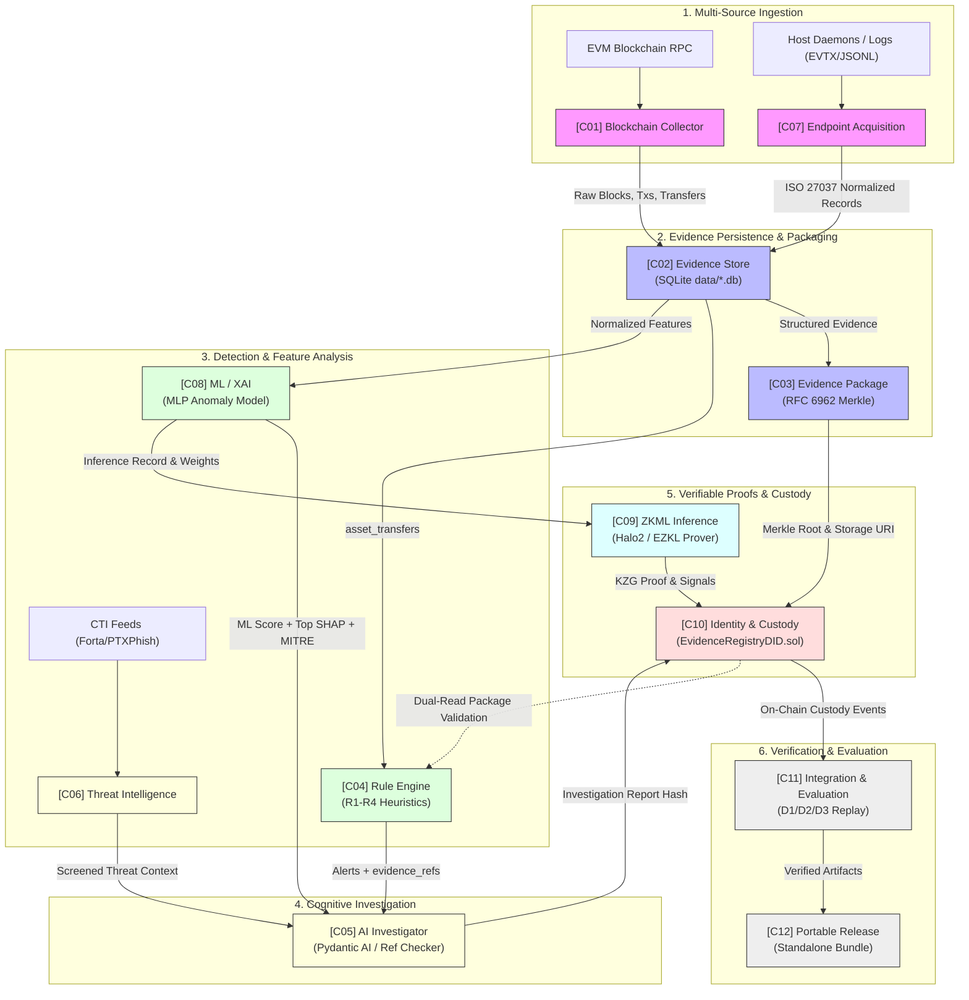

# TÀI LIỆU KIẾN TRÚC HỆ THỐNG ĐIỀU TRA SỐ BLOCKCHAIN VÀ AI
# SYSTEM ARCHITECTURE: VERIFIABLE BLOCKCHAIN + AI DIGITAL FORENSICS

- **Mã tài liệu / Document ID**: `SYSTEM_ARCHITECTURE`
- **Phiên bản / Version**: 2.0.0 (AGENT.md v6.0 Baseline)
- **Dự án / Project**: Blockchain + AI Digital Forensics System (Academic PoC — Đề tài 8)
- **Đặc tả căn cứ / Authoritative Specification**: `AGENT.md v6.0` (`C:\Users\Naly\Downloads\AGENT.md`)
- **Quy chuẩn danh xưng / Naming Standard**: 12 Functional Components (Requirement R4)
- **Trạng thái / Status**: AUTHORITATIVE & MAINTAINED

---

## 1. TỔNG QUAN KIẾN TRÚC HỆ THỐNG

Hệ thống **Blockchain + AI Digital Forensics** là một giải pháp thực nghiệm học thuật (Academic Proof of Concept - PoC) được thiết kế nhằm hiện thực hóa các mục tiêu nghiên cứu của **Đề tài 8: Điều tra số kết hợp Blockchain và AI** thuộc chương trình K18 An toàn Thông tin.

### 1.1 Ba Trụ Cột Nghiên Cứu Cốt Lõi
Hệ thống kết hợp ba trụ cột công nghệ tiên tiến để giải quyết bài toán toàn vẹn chứng cứ và tính minh bạch trong điều tra số:
1. **Trụ cột A — AI Agents & Explainable AI (XAI)**:
   Thu thập dấu vết có kiểm soát, phát hiện bất thường bằng học máy kết hợp tập luật tất định, giải thích quyết định suy luận bằng chỉ số định lượng SHAP, ánh xạ kỹ thuật MITRE ATT&CK có căn cứ và điều tra viên AI hoạt động trong khuôn khổ an toàn tuyệt đối.
2. **Trụ cột B — Smart Contract Chain of Custody & Decentralized Identity (DID)**:
   Quản lý chuỗi hành trình chứng cứ số bất biến bằng hợp đồng thông minh Solidity 0.8.24 trên máy ảo Ethereum (EVM), ràng buộc danh tính tác viên qua định danh phân tán W3C DID Core 1.0 (`did:ethr` / `did:key`), chữ ký có cấu trúc EIP-712 và tuân thủ các nguyên tắc của chuẩn ISO/IEC 27037.
3. **Trụ cột C — Zero-Knowledge Machine Learning (ZKML)**:
   Kiểm chứng tính toàn vẹn của quá trình suy luận AI bằng chứng minh không tiết lộ tri thức (ZK-SNARK / Halo2 KZG commitments). Ràng buộc mật mã học giữa mô hình, đầu vào, đầu ra và bằng chứng tính toán; cho phép xác minh on-chain mà không thể bị giả mạo.

### 1.2 Ranh giới phạm vi PoC Học thuật
Hệ thống được phát triển với tính chất là một nguyên mẫu thực nghiệm sẵn sàng vận hành (operational prototype) phục vụ đánh giá khoa học:
- Vận hành mặc định trên môi trường biệt lập (Offline / Local Anvil Loopback).
- Không mở rộng thành trung tâm điều hành an ninh mạng (SOC) quy mô công nghiệp.
- Không phát giao dịch lên mạng công khai (Mainnet/Sepolia) khi chưa có lệnh phê duyệt bằng văn bản.
- Không sử dụng API tính phí ngoài luồng; bảo vệ tuyệt đối dữ liệu cá nhân (PII) và khóa riêng tư (Private Keys).

---

## 2. SƠ ĐỒ KIẾN TRÚC TỔNG THỂ

### 2.1 Sơ đồ Phân tầng Kiến trúc (ASCII Architecture Diagram)

Hệ thống loại bỏ hoàn toàn các nhãn giai đoạn tuần tự P1–P12 và tổ chức thành 7 phân tầng kiến trúc với 12 thành phần chức năng chuẩn hóa:

```text
+===================================================================================================+
|                                    TẦNG 1: THU THẬP ĐA NGUỒN                                      |
|                                     (MULTI-SOURCE INGESTION)                                      |
|  [C01: Blockchain Collector]                              [C07: Endpoint Acquisition]             |
|  - EVM RPC Blocks / Txs / Receipts / Logs                 - ISO/IEC 27037 Ingestion Protocol      |
|  - 12-Block Chain Reorg Unwinder                          - Live Daemons (osquery / WMI)          |
|  - Atomic Checkpoint & RPC Failover                       - Static Logs (JSONL / EVTX)            |
|  - ETH & ERC-20 Asset Normalization                       - acquisition_manifest.json (UTC, SHA)  |
|  - Raw SHA-256 Digest Preservation                        - AI First Responder Policy Guards      |
+=================================================+=================================================+
                                                  |
                                                  v
+===================================================================================================+
|                                 TẦNG 2: LƯU TRỮ VÀ TOÀN VẸN CHỨNG CỨ                              |
|                                  (STORAGE & EVIDENCE INTEGRITY)                                   |
|  [C02: Evidence Store]                                    [C03: Evidence Package]                 |
|  - SQLite Append-Only Persistence                         - RFC 6962 Merkle Tree Commitments      |
|  - data/real_p4.db (Canonical Protected)                  - Canonical URI: evidence://sha256/...  |
|  - data/forensics.db (Canonical Protected)                - Sealing: raw_blocks.jsonl, timeline   |
|  - data/endpoint_evidence.db (Dedicated Store)            - manifest.json Manifest Authority      |
|  - Non-destructive Schema Migrations & Audit Journal      - Dual-Read Anchored Validation Loop    |
+=================================================+=================================================+
                         |                                                |
                         v                                                v
+=================================================+  +==============================================+
|       TẦNG 3: PHÁT HIỆN TẤT ĐỊNH                |  |            TẦNG 5: HỌC MÁY VÀ XAI            |
|        (DETERMINISTIC DETECTION)                |  |        (MACHINE LEARNING & LOCAL XAI)        |
|  [C04: Rule Engine]                             |  |  [C08: ML/XAI]                               |
|  - Heuristic Rules: R1 (Large Transfer P99)     |  |  - Decoupled Ground Truth (Zero Rule Leak)   |
|  - R2 (High Frequency), R3 (Fan-In / Fan-Out)   |  |  - Chronological Train/Val/Test Splits       |
|  - R4 (Rapid Pass-Through across 5 blocks)      |  |  - Decimal-Safe Normalized Token Quantities  |
|  - Decimal-Safe Asset Volume Calculations       |  |  - Compact MLP Anomaly Detector (ONNX Sync)  |
|  - Output: Alerts with SHA-256 evidence_refs    |  |  - Quantitative Local SHAP Fidelity/Stability|
|                                                 |  |  - Grounded MITRE ATT&CK & NOT_MAPPED Abstain|
+=================================================+  +==============================================+
                         \                                                /
                          \                                              /
                           v                                            v
+===================================================================================================+
|                              TẦNG 4: ĐIỀU TRA NHẬN THỨC VÀ TÌNH BÁO                               |
|                              (COGNITIVE INVESTIGATION & INTEL)                                    |
|  [C06: Threat Intelligence]                               [C05: AI Investigator]                  |
|  - Open-Source CTI Feeds (Forta, PTXPhish, MEW)           - Bounded Pydantic AI Investigation Agent|
|  - Open World Assumption (OWA) Screening Engine           - 5-Layer Read-Only SQLite Sandboxing   |
|  - Defense against CSV Formula Injection Attacks          - 38-Pattern Prompt Injection Sanitizer |
|  - Canonical benchmark dataset (data/benchmark_p6.db)     - 5-Step Tool Budget Execution Limit    |
|                                                           - Two-Stage Citation Ref Checker Engine |
+=================================================+=================================================+
                         |                                                |
                         v                                                v
+=================================================+  +==============================================+
|       TẦNG 6: TÍNH TOÁN CÓ THỂ KIỂM CHỨNG       |  |       TẦNG 7: ĐỊNH DANH VÀ CHUỖI HÀNH TRÌNH  |
|             (VERIFIABLE COMPUTATION)            |  |          (IDENTITY & CHAIN OF CUSTODY)       |
|  [C09: ZKML Verifiable Inference]               |  |  [C10: Identity & Custody]                   |
|  - Fixed-Point Arithmetic Halo2 Circuit         |  |  - EvidenceRegistry.sol & EvidenceRegistryDID|
|  - Real EZKL Proof Generation (No Mocks)        |  |  - W3C DID Core 1.0 (did:ethr / did:key)     |
|  - KZG Polynomial Commitments                   |  |  - Granular RBAC (Collector, Analyst, Custody)|
|  - 5-Part Binding Digest (Model/Circ/In/Out/ID) |  |  - EIP-712 Structured Typed Signatures       |
|  - Automated Tamper Rejection Engine            |  |  - Anti-Replay Monotonic Nonce & Deadlines   |
|  - Local Anvil On-Chain Verifier Contract       |  |  - ISO/IEC 27037 2-Actor Custody Handover    |
+=================================================+  +==============================================+
                         \                                                /
                          \                                              /
                           v                                            v
+===================================================================================================+
|                               TẦNG 8: TÍCH HỢP, THỰC NGHIỆM VÀ PHÁT HÀNH                          |
|                                (INTEGRATION, EVALUATION & RELEASE)                                |
|  [C11: Integration & Evaluation]                          [C12: Portable Release]                 |
|  - D1: EVM Incident Case Replay Pipeline                  - Standalone Independent Windows Bundle |
|  - D2: Endpoint Host Log Replay (ISO 27037)               - PowerShell Automated Test Runners     |
|  - D3: Multi-Gateway Adversarial Replay                   - 101-Package Offline Wheelhouse        |
|  - End-to-End Traceable Audit Report Generator            - SHA256SUMS.txt Cryptographic Manifest |
|  - Distinct ML, XAI, CoC, and ZKML Metric Suites          - Zero Hardcoded Paths (Gate T25 Pass)  |
+===================================================================================================+
```

---

### 2.2 Sơ đồ Luồng Dữ liệu và Tương tác (Mermaid Flowchart)



---

## 3. ĐẶC TẢ CHI TIẾT 12 THÀNH PHẦN CHỨC NĂNG

### [C01] Blockchain Collector
- **Trách nhiệm**: Kết nối trực tiếp đến các nút EVM RPC thông qua giao thức JSON-RPC, thu thập tuần tự hoặc backfill các khối, giao dịch, biên nhận và nhật ký sự kiện; tự động chuẩn hóa các giao dịch ETH bản địa và token ERC-20 (`Transfer`, `Approval`) vào bảng `asset_transfers`.
- **Hợp đồng giao diện & Chịu lỗi**:
  - Tự động kích hoạt cơ chế Exponential Backoff khi gặp lỗi mạng hoặc HTTP 429 (Too Many Requests).
  - Unwinder xử lý reorg 12 khối: lưu trữ con trỏ checkpoint nguyên tử, phát hiện chuỗi phân nhánh bằng so sánh mã băm khối cha mẹ (`parentHash`), thu hồi các bản ghi mồ côi (orphaned blocks) và tái thu thập nhánh chính.
- **Cam kết mật mã**: Mọi khối và giao dịch đều lưu trữ nguyên văn chuỗi JSON gốc (`raw_json`) kèm mã băm SHA-256 (`raw_sha256`) tại thời điểm thu thập.

### [C02] Evidence Store
- **Trách nhiệm**: Lớp lưu trữ dữ liệu trung tâm, đóng vai trò là "Kho chứng cứ số" bất biến phục vụ toàn bộ chuỗi phân tích.
- **Cấu trúc lưu trữ**:
  - `data/real_p4.db`: CSDL chuẩn chứa dữ liệu các vụ việc thực tế (Euler Finance, Curve alETH,...), được niêm phong mật mã học (PROTECTED).
  - `data/forensics.db`: CSDL chứng cứ hoạt động chính, quản lý bảng khối, giao dịch, chuyển giao tài sản, cảnh báo và nhật ký kiểm toán.
  - `data/endpoint_evidence.db`: CSDL chuyên biệt lưu trữ chứng cứ thu thập từ máy chủ/endpoint, tách bạch hoàn toàn với dữ liệu blockchain.
- **Tính toàn vẹn**: Thực thi ngữ nghĩa append-only (nghiêm cấm lệnh `INSERT OR REPLACE` hoặc `UPDATE` làm thay đổi lịch sử), ghi nhật ký `audit_events` cho mọi thao tác hệ thống.

### [C03] Evidence Package
- **Trách nhiệm**: Đóng gói các tập hợp chứng cứ số rời rạc thành một gói bằng chứng có cấu trúc tự chứng minh (self-authenticating evidence package).
- **Cơ chế mật mã**:
  - Xây dựng cây Merkle theo chuẩn **RFC 6962** từ danh sách các tệp chứng cứ (`raw_blocks.jsonl`, `asset_transfers.csv`, `timeline.csv`,...).
  - Định danh gói chứng cứ bằng URI chuẩn hóa: `evidence://sha256/<case_hash>/<manifest_hash>/manifest.json` (chiều dài tối đa 256 ký tự, chuẩn ASCII).
  - Sinh tệp `manifest.json` được ký điện tử, chứa thông tin nguồn gốc (Git commit, phiên bản công cụ, thời điểm UTC, người thực hiện).

### [C04] Rule Engine
- **Trách nhiệm**: Động cơ phát hiện bất thường mang tính tất định, dựa trên 4 luật phân tích hành vi dòng tiền trên mạng Ethereum Mainnet:
  - **R1 (`large_transfer`)**: Giao dịch chuyển tiền có giá trị vượt ngưỡng phân vị P99 (hoặc fallback 10 ETH đối với native token).
  - **R2 (`high_frequency`)**: Tần suất giao dịch bất thường ($\ge 10$ giao dịch trong cửa sổ 300 giây).
  - **R3 (`fan_in_out`)**: Mô hình gom quỹ hoặc tán quỹ bất thường ($\ge 8$ đối tác trong cửa sổ 900 giây cùng loại tài sản).
  - **R4 (`rapid_pass_through`)**: Luân chuyển tiền siêu tốc qua tài khoản trung gian trong vòng 5 khối với tỷ lệ tiền vào/ra đạt 0.80–1.05.
- **An toàn tính toán**: Xử lý an toàn đơn vị thập phân của token (`normalized_amount = raw_amount / 10^decimals`), nghiêm cấm cộng gộp trực tiếp số lượng thô giữa các token khác nhau. Mọi cảnh báo sinh ra đều có `alert_id` (SHA-256) và danh sách liên kết chứng cứ gốc `evidence_refs`.

### [C05] AI Investigator
- **Trách nhiệm**: Tác nhân điều tra nhận thức xây dựng trên nền tảng Pydantic AI, đóng vai trò trợ lý pháp chứng tự động phân tích cảnh báo, tổng hợp dữ kiện và đề xuất báo cáo kết luận.
- **Khuôn khổ an toàn 4 lớp (Safety Guardrails)**:
  1. **5-Layer Read-Only SQLite Sandboxing**: Kết nối CSDL với cờ `mode=ro`, thiết lập `sqlite3` authorizer chặn toàn bộ lệnh DDL/DML, kích hoạt `PRAGMA query_only = ON`, ngắt kết nối ghi và cô lập connection pool.
  2. **Prompt Injection Sanitizer**: Bộ lọc chủ động nhận diện và vô hiệu hóa 38 mẫu tiêm mã độc tiềm ẩn trong dữ liệu on-chain (ví dụ chuỗi giả mạo lệnh hệ thống trong ERC-20 token name hoặc input data).
  3. **Ngân sách 5 bước (5-Step Budget)**: Giới hạn tối đa 5 bước gọi công cụ (`MAX_AI_TOOL_STEPS = 5`) để triệt tiêu nguy cơ vòng lặp vô tận hoặc cạn kiệt tài nguyên.
  4. **Two-Stage Ref Checker**: Bộ kiểm tra trích dẫn độc lập xác thực tính tồn tại khách quan và tính chính xác giá trị của mọi trích dẫn chứng cứ; phân định nghiêm ngặt giữa dữ kiện thực tế (`ObservedFact`) và nhãn mối đe dọa bên ngoài (`ExternalThreatLabel`).

### [C06] Threat Intelligence
- **Trách nhiệm**: Tiếp nhận, chuẩn hóa và đối chiếu thông tin tình báo mối đe dọa từ các nguồn mở uy tín (Forta Network, PhishTank/PTXPhish, MyEtherWallet).
- **Nguyên tắc phân tích**:
  - Phòng chống tấn công CSV Formula Injection (khử khuẩn các ký tự nguy hiểm `=`, `+`, `-`, `@`).
  - Đánh giá theo **Giả định Thế giới Mở (Open World Assumption - OWA)**: Một địa chỉ không xuất hiện trong blacklist không đồng nghĩa với việc địa chỉ đó là trong sạch (benign). Không đánh đồng việc 0 match blacklist là 0 false positive.
  - Quản lý tập benchmark chuẩn 34.841 bản ghi trong `data/benchmark_p6.db`.

### [C07] Endpoint Acquisition
- **Trách nhiệm**: Mở rộng phạm vi điều tra số sang hạ tầng máy chủ và thiết bị đầu cuối theo chuẩn quốc tế **ISO/IEC 27037**.
- **Quy trình 4 bước**: Nhận diện (Identification) -> Thu thập (Collection) -> Sao chép (Acquisition) -> Bảo quản (Preservation).
- **Giao diện & Nguồn dữ liệu**:
  - Thực thi giao diện `EvidenceSourceAdapter` trừu tượng.
  - Hỗ trợ nguồn sống: Daemon osquery / Windows WMI thu thập thông tin tiến trình, kết nối mạng và khóa khởi động.
  - Hỗ trợ nguồn tĩnh: Nhập log xuất tĩnh dạng JSONL hoặc Windows Event Log (.EVTX) chuẩn hóa.
- **Hồ sơ thu thập**: Tự động sinh `acquisition_manifest.json` ghi nhận phạm vi đồng thuận (`consent_scope`), mã băm gốc `original_sha256`, mã băm bản sao `copy_sha256`, mốc thời gian UTC và ID tác viên.
- **AI First Responder Bounds**: Tuyệt đối KHÔNG tự ý thực thi shell, không xóa/sửa log hệ thống, không thay đổi ACL tập tin, không tự cô lập card mạng và không tự ký giao dịch.

### [C08] Machine Learning & Explainable AI (ML/XAI)
- **Trách nhiệm**: Phát hiện bất thường bằng học máy thực chất kết hợp giải thích mô hình định lượng và ánh xạ kỹ thuật tấn công MITRE ATT&CK.
- **Quy trình Thực nghiệm**:
  - **Ground Truth Độc lập**: Nhãn dữ liệu huấn luyện được xác lập từ dữ liệu giao dịch chuẩn, độc lập hoàn toàn với bảng `alerts` của Rule Engine (triệt tiêu rò rỉ nhãn tự sinh).
  - **Phân chia không rò rỉ**: Chia tập train/val/test theo trình tự thời gian (chronological split); bộ chuẩn hóa đặc trưng (Scaler) được fit DUY NHẤT trên tập train.
  - **Mô hình học máy**: Mạng nơ-ron Perceptron đa tầng (Compact MLP) nhỏ gọn, được đồng bộ hóa nhất quán từng bit trọng số với định dạng ONNX (`anomaly_detector_v1.onnx`).
- **XAI Định lượng**: Áp dụng phương pháp SHAP cục bộ (Local SHAP Attribution) để đo lường mức độ đóng góp của từng đặc trưng; đo lường độ trung thực (fidelity) và độ ổn định (stability); từ chối giải thích (`NOT_EXPLAINABLE`) khi không đủ độ tin cậy.
- **Ánh xạ MITRE ATT&CK**: Bảng ánh xạ kỹ thuật với điều kiện chứng cứ bắt buộc (`required_evidence`); có cơ chế dừng (**abstain / `NOT_MAPPED`**) đối với các giao dịch EVM thuần túy không đủ căn cứ gán nhãn Enterprise ATT&CK.

### [C09] ZKML Verifiable Inference
- **Trách nhiệm**: Cung cấp bằng chứng mật mã học chứng minh rằng một suy luận AI cụ thể đã được tính toán chính xác trên một mô hình đã định danh và một đầu vào đã cam kết, mà không bị can thiệp bởi bên thứ ba.
- **Thiết kế Mạch số học & Cam kết**:
  - Sử dụng framework ZKML thực tế (Halo2 / EZKL), nói không với mock proof.
  - Lượng tử hóa mô hình sang dạng số học fixed-point phù hợp với mạch ZK.
  - Cam kết đa thức KZG cho vector đầu vào và kết quả đầu ra.
- **Ràng buộc Mật mã học (Cryptographic Binding)**:
  Tính toán mã băm ràng buộc 5 thành phần:
  $$\text{binding\_hash} = \text{SHA256}(\text{model\_hash} \parallel \text{circuit\_version} \parallel \text{input\_commitment} \parallel \text{output\_commitment} \parallel \text{inference\_record\_id})$$
- **Khả năng Chống can thiệp (Tamper Rejection)**: Tự động từ chối khi sửa đổi bất kỳ byte nào của tệp proof, làm lệch public signals hoặc thay đổi cam kết đầu vào/đầu ra.
- **Hợp đồng Xác minh On-Chain**: Triển khai `InferenceVerifier.sol` trên Anvil (biên dịch bằng Foundry `--via-ir`), ghi nhận lượng gas tiêu thụ và receipt xác minh.

### [C10] Identity & Custody
- **Trách nhiệm**: Quản lý chuỗi hành trình chứng cứ và danh tính người điều tra trên hợp đồng thông minh blockchain.
- **Hợp đồng Lõi**: `EvidenceRegistry.sol` và phần mở rộng `EvidenceRegistryDID.sol` viết bằng Solidity 0.8.24.
- **Cơ chế Định danh & Phân quyền**:
  - Tích hợp chuẩn **W3C DID Core 1.0** (`did:ethr` / `did:key`), ràng buộc tường minh giữa DID $\leftrightarrow$ Khóa công khai $\leftrightarrow$ Địa chỉ ví Ethereum.
  - Hệ thống phân quyền RBAC đa vai trò: Collector, Investigator/Analyst, EvidenceCustodian, ZKMLVerifier.
- **Bảo mật Giao dịch**:
  - Chữ ký có cấu trúc theo chuẩn **EIP-712** với domain separator định danh.
  - Chống tấn công phát lại (Replay Attack) bằng chuỗi nonce đơn điệu (`monotonic nonce`) và thời hạn giao dịch (`deadline`).
  - Giao dịch nguyên tử qua Compare-And-Swap (CAS) trên SQLite: `UPDATE onchain_operations SET state='SEND_STARTED' WHERE state='READY'`.
  - Cơ chế **Zero Automatic Retries**: Khi gặp sự cố mạng hoặc timeout, chuyển trạng thái sang `UNKNOWN` và tạo tệp phục hồi redacted sidecar, tuyệt đối không tự động gửi lại làm trùng lặp nonces.
- **Quy trình Chuyển giao 2 Tác viên**: Trình diễn luồng chuyển giao chứng cứ giữa 2 tác viên với biên nhận Anvil và đối chiếu khớp mã băm 100%.

### [C11] Integration & Evaluation
- **Trách nhiệm**: Điều phối các kịch bản kiểm thử tích hợp đầu cuối, đánh giá hiệu năng và xuất báo cáo pháp chứng toàn diện.
- **Ba Kịch bản Thực nghiệm Trọng yếu**:
  - **Demo D1 (EVM Replay)**: Tái hiện vụ việc tấn công blockchain từ khối EVM thô $\rightarrow$ Collector $\rightarrow$ Store $\rightarrow$ Rule/ML $\rightarrow$ XAI $\rightarrow$ Investigator $\rightarrow$ Package $\rightarrow$ Custody/DID $\rightarrow$ ZKML Proof $\rightarrow$ Báo cáo cuối.
  - **Demo D2 (Host Replay)**: Tái hiện vụ việc thu thập máy chủ từ log tĩnh ISO 27037 $\rightarrow$ Store $\rightarrow$ First Responder $\rightarrow$ Rule/ML $\rightarrow$ Custody $\rightarrow$ Báo cáo cuối.
  - **Demo D3 (Multi-Gateway Adversarial Replay)**: Tái hiện chuỗi tấn công đối kháng đa cổng nhằm kiểm tra khả năng phòng thủ của hệ thống: sửa dữ liệu thô, tiêm prompt injection, sửa cam kết ML, thay đổi proof bytes, giả mạo chữ ký DID.
- **Báo cáo Truy vết**: Sinh báo cáo pháp chứng truy vết ngược xuyên suốt từ bằng chứng ban đầu đến giao dịch on-chain.

### [C12] Portable Release
- **Trách nhiệm**: Đóng gói toàn bộ mã nguồn, cấu hình, dữ liệu mẫu, mô hình học máy, mạch ZK và tài liệu thành một gói phân phối độc lập chạy offline trên hệ điều hành Windows x64.
- **Tiêu chuẩn Đóng gói Độc lập**:
  - Triệt tiêu 100% các đường dẫn tuyệt đối hardcoded (như `D:\Projest` hoặc username máy nguồn).
  - Tự động hóa qua các tệp kịch bản PowerShell: `setup.ps1`, `smoke_test.ps1`, `run_full_tests.ps1`, `verify_integrity.ps1`.
  - Kèm theo thư mục wheelhouse chứa đầy đủ 101 gói thư viện Python cài đặt offline không cần Internet.
  - Tệp kiểm tra mã băm toàn vẹn `SHA256SUMS.txt`.
  - Bộ 3 tài liệu bắt buộc: `README_SETUP.md`, `PORTABILITY_TEST_REPORT.md`, `LICENSES_AND_DATA_RIGHTS.md`.

---

## 4. CÁC MÔ HÌNH THỰC THI CA ĐIỀU TRA PHÁP CHỨNG

### 4.1 Mô hình 1 (Demo D1): Ca Điều tra Sự cố EVM On-Chain
```text
[EVM Node / RPC] 
       │
       ▼
[Blockchain Collector] ──(raw_json, raw_sha256)──► [Evidence Store: forensics.db]
                                                               │
                                                               ▼
[Rule Engine (R1-R4)] ◄────(asset_transfers)───────────────────┤
       │                                                       │
       ▼ (alerts + evidence_refs)                              ▼
[AI Investigator] ◄───(ML anomaly + SHAP + MITRE)─── [ML/XAI Pipeline]
       │                                                       │
       ▼ (validated findings)                                  ▼ (model & inputs)
[Evidence Package] ──(Merkle URI)──► [EvidenceRegistryDID] ◄── [ZKML Prover / Verifier]
                                             │
                                             ▼
                                [Traceable Forensic Report]
```

### 4.2 Mô hình 2 (Demo D2): Ca Điều tra Dấu vết Máy chủ (ISO/IEC 27037)
```text
[Host Security Logs / EVTX / JSONL]
       │
       ▼
[Endpoint Acquisition] ──(manifest, consent, original/copy SHA)──► [data/endpoint_evidence.db]
                                                                              │
                                                                              ▼
[AI First Responder (Policy Guards)] ─────────────────────────────► [Rule / ML Engine]
                                                                              │
                                                                              ▼
[Traceable Audit Report] ◄────── [EvidenceRegistryDID] ◄────── [Evidence Package (URI)]
```

### 4.3 Mô hình 3 (Demo D3): Kiểm thử Đối kháng Đa tầng (Adversarial Defense)
Hệ thống thiết lập 5 cổng kiểm soát đối kháng:
1. **Cổng 1 (Data Tampering)**: Sửa đổi 1 byte trong dữ liệu thô $\rightarrow$ Evidence Store đối chiếu SHA-256 phát hiện và dừng xử lý (`INTEGRITY_MISMATCH`).
2. **Cổng 2 (Cognitive Attack)**: Đưa lệnh tiêm mã độc vào tên token on-chain $\rightarrow$ Sanitizer nhận diện 38 mẫu và vô hiệu hóa (`PROMPT_INJECTION_DETECTED`).
3. **Cổng 3 (Attribution Fabrication)**: AI tạo kết luận không có trong chứng cứ $\rightarrow$ Ref Checker kiểm tra và loại bỏ trích dẫn sai lệch (`UNVERIFIED_CITATION`).
4. **Cổng 4 (ZKML Proof Tampering)**: Sửa 1 byte trong proof hoặc tráo đổi public signals $\rightarrow$ Verifier từ chối ngay lập tức (`VERIFICATION_FAILED`).
5. **Cổng 5 (Identity & Replay Attack)**: Dùng lại chữ ký cũ hoặc sai DID/Role $\rightarrow$ Hợp đồng thông minh revert giao dịch (`INVALID_SIGNER` / `NONCE_EXPIRED`).

### 4.4 Mô hình 4: Luồng Xác thực Hai chiều (Anchored Evidence Reverse Loop)
Để bảo đảm bằng chứng đã được lưu trên blockchain có thể được xác minh độc lập mà không tin tưởng mù quáng vào CSDL cục bộ:
1. Module `forensics.rules.anchored` truy vấn hợp đồng `EvidenceRegistryDID.sol` để lấy mã băm manifest đã đăng ký.
2. Tải các tệp chứng cứ nguyên bản từ gói bằng chứng tương ứng.
3. Tái lập một CSDL SQLite tạm thời hoàn toàn trên bộ nhớ (`:memory:`) từ các byte chứng cứ đã được xác thực mã băm.
4. Chạy lại tập luật R1–R4 trên CSDL tạm thời này với cờ `persist=False`.
5. Đối chiếu kết quả cảnh báo sinh ra với báo cáo ban đầu, bảo đảm tính toàn vẹn 100%.

---

## 5. RANH GIỚI TIN CẬY VÀ MÔ HÌNH BẢO MẬT

Hệ thống thiết lập 4 ranh giới tin cậy (Trust Boundaries) nghiêm ngặt:

```text
                           [KHÔNG TIN CẬY / UNTRUSTED]
        EVM RPC Data | Endpoint Logs | Threat Intel Feeds | LLM Output
─────────────────────────────────────────────────────────────────────────────
                             RANH GIỚI TIN CẬY 1: NẠP DỮ LIỆU
        - SHA-256 Digest Sealing
        - Schema Validation
        - CSV Formula Sanitization
─────────────────────────────────────────────────────────────────────────────
                             RANH GIỚI TIN CẬY 2: ĐIỀU TRA NHẬN THỨC
        - 5-Layer SQLite Read-Only (mode=ro, authorizer, query_only)
        - 38-Pattern Prompt Injection Sanitizer
        - MAX_AI_TOOL_STEPS = 5 Budget
        - Two-Stage Ref Checker (ObservedFact vs ExternalThreatLabel)
─────────────────────────────────────────────────────────────────────────────
                             RANH GIỚI TIN CẬY 3: MẬT MÃ HỌC KIỂM CHỨNG
        - RFC 6962 Merkle Tree Roots
        - KZG Polynomial Commitments
        - 5-Part Binding Digest
        - Halo2 Arithmetic Circuit Constraints
─────────────────────────────────────────────────────────────────────────────
                             RANH GIỚI TIN CẬY 4: ON-CHAIN CUSTODY & AN TOÀN KHÓA
        - W3C DID Core 1.0 & Granular RBAC
        - EIP-712 Structured Signatures (Anti-Replay Monotonic Nonces)
        - Atomic CAS State Claims & Zero Auto Retries
        - Khóa mặc định Broadcast lên Public Chain (Local Anvil Loopback Only)
        - Tuyệt đối không ghi PII, Private Keys, Raw Prompts lên Blockchain
─────────────────────────────────────────────────────────────────────────────
                             [HOÀN TOÀN TIN CẬY / CRYPTOGRAPHICALLY SECURED]
```

---

## 6. MÔ HÌNH VẬN HÀNH VÀ TRIỂN KHAI

### 6.1 Môi trường Phát triển & Kiểm thử Cục bộ (Local Development)
- **Hệ điều hành**: Microsoft Windows 10 / Windows 11 (64-bit AMD64).
- **Môi trường Python**: Python 3.13.14 (64-bit) với môi trường ảo cách ly.
- **Hạ tầng Blockchain Cục bộ**: Foundry 1.8.7 (`anvil.exe`, `forge.exe`, `cast.exe`) chạy loopback trên `http://127.0.0.1:8545` với chain ID 31337.
- **Công cụ Kiểm thử**: Pytest 9.2.0 thực thi bộ kiểm thử 1.521 ca kiểm thử; Forge thực thi 112 ca kiểm thử smart contract.

### 6.2 Môi trường Bản phát hành Độc lập (Standalone Portable Release)
- Đóng gói trọn gói trong thư mục `dist/` hoặc thư mục giải nén độc lập.
- Chạy hoàn toàn offline với thư mục `wheels/` chứa 101 gói Python.
- Vận hành qua các lệnh PowerShell chuẩn hóa:
  ```powershell
  # Cài đặt môi trường độc lập
  .\setup_env.bat  # hoặc .\setup.ps1

  # Kích hoạt môi trường
  .\venv\Scripts\Activate.ps1

  # Chạy toàn bộ kiểm thử
  .\run_tests.bat  # hoặc .\run_full_tests.ps1

  # Chạy thực nghiệm đánh giá
  .\run_evaluation.bat
  ```
- Kiểm tra tính toàn vẹn gói:
  ```powershell
  python scripts\portable.py verify <path_to_zip>
  ```
