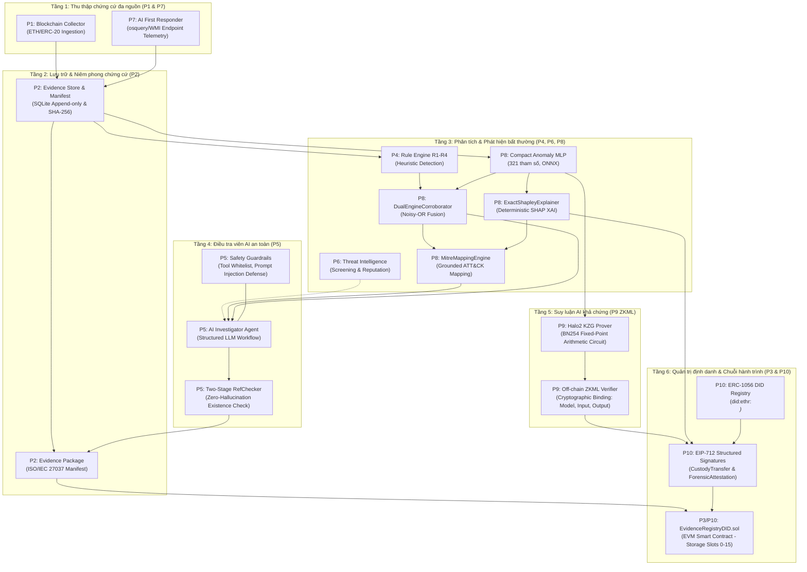

# BÁO CÁO TÍCH HỢP TOÀN DIỆN HỆ THỐNG P1–P10
**Dự án:** Blockchain + AI Digital Forensics – Đề tài 8: Điều tra số kết hợp Blockchain và AI  
**Thời điểm hoàn thành:** 2026-11-04T17:05:00Z  
**Môi trường:** Windows 11, Python 3.13, Foundry 1.6.0-rc1, SQLite 3.x, Halo2 / EZKL, Solidty 0.8.24  
**Nhánh Git:** `integration/p7-p10-dev`  
**Mã kiểm soát tính toàn vẹn (Golden Hashes):**
- `data/real_p4.db`: `6BD9AED48AC2742D0862198BFF65994861244EC681DC8ABEB3E6F771E7808C97`
- `data/forensics.db`: `3F2B0DFC772A96FF6EA57C65807B5B6B9A20FCF74C409C6F222FCFF29F1EF001`
- `data/benchmark_p6.db`: `C7FF724CD214EEF57E58A6FBE44DBEB2712C54B035907B2A6279A255C0E80507`
- `.env`: `C2F4879666CD21276C58EC75DE923C8235D414F3D646A854A835C5638EC1699C`

---

## 1. TỔNG QUAN KIẾN TRÚC TOÀN HỆ THỐNG (P1–P10)

Hệ thống điều tra kỹ thuật số kết hợp Blockchain và AI (Đề tài 8) được xây dựng theo kiến trúc phân tầng đa lớp, bảo đảm chuỗi hành trình chứng cứ (Chain of Custody) đạt chuẩn quốc tế **ISO/IEC 27037:2012**, kết hợp khả năng phát hiện mối đe dọa bằng Rule Engine và Mạng nơ-ron học máy (Compact MLP 321 tham số), giải thích quyết định bằng XAI tất định (Exact SHAP), xác minh tính toàn vẹn suy luận AI bằng Zero-Knowledge Machine Learning (ZKML Halo2 BN254 KZG), và neo giữ định danh phân tán (ERC-1056 DID) kèm chữ ký cấu trúc EIP-712 trên EVM Smart Contract.

---

## 2. LUỒNG DỮ LIỆU ĐIỀU TRA ĐẦU CUỐI (END-TO-END DATAFLOW)

### Giai đoạn 1: Thu thập chứng cứ đa nguồn (P1 & P7)
1. **Blockchain Telemetry (P1):** Thu thập và chuẩn hóa dữ liệu khối, giao dịch, và sự kiện chuyển dịch tài sản ERC-20 từ mạng Ethereum/EVM vào kho `data/real_p4.db`.
2. **Endpoint Telemetry (P7):** AI First Responder truy vấn định kỳ hoặc theo sự kiện thông qua `OsqueryProvider` hoặc `WMIPowerShellFallbackProvider`. Dữ liệu tiến trình (`ProcessRecord`), kết nối mạng (`SocketRecord`), và nhật ký sự kiện (`EventRecord`) được chuẩn hóa và ghi nhận vào kho tách biệt `data/endpoint_evidence.db` dưới dạng append-only.
3. **Ranh giới an toàn (SafetyGuard):** Chặn đứng 100% các hành vi nguy hiểm: thực thi shell tùy ý (cmd/powershell/bash), xóa/sửa nhật ký sự kiện, can thiệp quyền ACL/file system, tự ý cô lập mạng vật lý hoặc ký giao dịch blockchain trực tiếp.

### Giai đoạn 2: Lưu trữ, Phân tích & Phát hiện bất thường (P2, P4, P8)
1. **Gói chứng cứ số (P2):** Đóng gói chứng cứ thành các thư mục vụ án chuẩn ISO/IEC 27037 kèm tệp `manifest.json` ghi nhận hàm băm SHA-256 từng thành phần và hàm băm gốc của toàn bộ gói.
2. **Động cơ luật (P4):** Thực thi các tập luật chuyên sâu (R1: Token Spoofing, R2: Fast Drain, R3: Reentrancy/Flash Loan, R4: Privileged Access Abuse) trên các giao dịch thực nghiệm.
3. **Mạng học máy Compact MLP (P8):** Trích xuất véc-tơ đặc trưng 10 chiều (`extract_single_address_features`), chuẩn hóa phi tham số qua `RobustFeatureScaler`, và đưa qua mạng Compact MLP 321 tham số (`models/anomaly_detector_v1.onnx`) để tính toán điểm số bất thường $S_{ML} \in [0.0, 1.0]$.
4. **Hợp nhất xác suất Noisy-OR (P8):** Kết hợp kết quả từ Rule Engine và ML Anomaly Detector thông qua bộ hợp nhất `DualEngineCorroborator` với trọng số phân bổ minh bạch.
5. **Giải thích quyết định bằng XAI tất định (P8):** Thuật toán `ExactShapleyExplainer` tính toán chính xác giá trị đóng góp Shapley của từng đặc trưng theo định lý hiệu quả (Efficiency Property: $\sum \phi_i = f(x) - \mathbb{E}[f]$) mà không dùng lấy mẫu xấp xỉ ngẫu nhiên.
6. **Ánh xạ MITRE ATT&CK (P8):** Ánh xạ các hành vi bất thường sang các kỹ thuật MITRE ATT&CK (`T1566.002`: Spearphishing / Approval Scam, `T1027`: Obfuscation, `T1048.003`: Exfiltration over Alternative Protocol / Bridge Hop, `T1499.004`: Endpoint DoS, `T1565.001`: Data Manipulation / Balance Drain) kèm yêu cầu bắt buộc: mọi ánh xạ phải có tham chiếu chứng cứ cụ thể (tx hash, block ref). Nếu không có chứng cứ, hệ thống lập tức báo lỗi `UnsubstantiatedMappingError`.

### Giai đoạn 3: Điều tra viên AI có kiểm soát & Kiểm tra toàn vẹn (P5)
1. **AI Investigator (P5):** Điều tra viên AI tiếp nhận thông tin từ Evidence Store, P4 Rule Engine, P8 ML/XAI, và P6 Threat Intelligence.
2. **Kiểm soát phạm vi (Tool Whitelist):** AI chỉ được phép gọi các công cụ trong danh sách ủy quyền an toàn (`AUTHORIZED_TOOLS`), bao gồm: `get_alerts`, `get_tx`, `get_address_history`, `get_counterparties`, `get_timeline`, `collect_missing_range`, `query_endpoint_telemetry`, `run_safe_endpoint_triage`, và `get_ml_anomaly_analysis`.
3. **Bảo vệ chống Prompt Injection:** Phân định nghiêm ngặt giữa dữ liệu quan sát khách quan (`ObservedFact`) và các phán đoán chủ quan. Lược đồ `ObservedFact` kiên quyết từ chối từ vựng ML/MITRE để ngăn chặn việc biến nhận định suy diễn thành dữ liệu sự kiện khách quan.
4. **Two-Stage RefChecker:** Đối soát 100% mã băm giao dịch và tham chiếu chứng cứ do AI trích dẫn với cơ sở dữ liệu thật. Mọi mã băm ảo tưởng (hallucination) đều bị phát hiện và hạ tỷ lệ `existence_ref_ratio < 1.0`.

### Giai đoạn 4: Xác minh suy luận AI bằng ZKML (P9)
1. **Halo2 Arithmetic Circuit:** Mạng Compact MLP 321 tham số được lượng tử hóa số học cố định (fixed-point arithmetic, scale $S=7$) và chuyển đổi thành hệ ràng buộc đa thức R1CS/Plonkish trên trường vô hướng của đường cong elliptic **BN254**.
2. **Tạo bằng chứng Halo2 KZG:** `ZKMLProver` sinh bằng chứng không tiết lộ tri thức (kích thước chuẩn 5.504 bytes, SHA-256 định danh) cho quá trình suy luận mà không cần tiết lộ đặc trưng nhạy cảm của địa chỉ.
3. **Off-chain Verifier:** `ZKMLVerifier` giải mã trực tiếp 11 phần tử vô hướng từ public instances (10 đặc trưng đầu vào lượng tử hóa + 1 điểm đầu ra), kiểm tra ràng buộc mật mã với mã băm mô hình ONNX (`model_hash`) và cam kết dữ liệu đầu vào (`input_commitment`).
4. **Phân định ranh giới trung thực:** Phân hệ off-chain ZKML đạt trạng thái vận hành thực tế (**LIVE OPERATIONAL**). Module on-chain EVM Verifier được ghi nhận trung thực ở mức độ nghiên cứu thiết kế (**DESIGN ONLY / PROTOTYPE INCOMPLETE**).

### Giai đoạn 5: Chuỗi hành trình chứng cứ ISO/IEC 27037 & Định danh DID (P3 & P10)
1. **Phân giải W3C DID (ERC-1056):** Mỗi điều tra viên, AI First Responder, và ZKML Verifier được gán một định danh phân tán chuẩn W3C DID Core 1.0 dạng `did:ethr:<ethereum_address>`.
2. **Ký số có cấu trúc EIP-712:**
   - `CustodyTransfer`: Ký biên bản bàn giao chứng cứ giữa các bên giám hộ (`fromCustodian`, `toCustodian`, `artifactSha256`, `nonce`, `deadline`).
   - `ForensicAttestation`: Ký chứng thực kỹ thuật số cho kết quả phân tích XAI hoặc kết quả kiểm chứng ZKML (`role`, `artifactHash`, `statementHash`, `nonce`, `deadline`).
3. **Hợp đồng thông minh `EvidenceRegistryDID.sol`:**
   - Kế thừa tuyến tính từ hợp đồng gốc `EvidenceRegistry.sol` của P3, bảo toàn nguyên vẹn 100% các storage slots 0–6 và ABI tương thích ngược.
   - Bổ sung hệ thống phân quyền vai trò RBAC đồng bộ 2 chiều (`ROLE_COLLECTOR`, `ROLE_ANALYST`, `ROLE_FIRST_RESPONDER`, `ROLE_ZKML_VERIFIER`, `ROLE_CUSTODIAN`).
   - Kiểm tra chặt chẽ chữ ký EIP-712: loại trừ tấn công High-$s$ Malleability ($s \le n/2$), chống Replay cross-chain qua `block.chainid`, chống Replay cross-contract qua `address(this)`.
4. **Bảo mật không rò rỉ (Zero-Leakage Guarantee):** Quét phát hiện canaries bảo đảm 100% không phát tán khóa bí mật, token API hoặc thông tin nhận dạng cá nhân (PII) lên chuỗi khối hoặc vào các payload chứng thực công khai.

---

## 3. MA TRẬN ĐỐI CHIẾU TIÊU CHÍ ĐỀ TÀI 8 (TRACEABILITY MATRIX)

| STT | Yêu cầu của Đề tài 8 & Đề cương | Phân hệ đáp ứng | Trạng thái kỹ thuật | Bằng chứng kiểm thử & Mã nguồn |
| :---: | :--- | :---: | :---: | :--- |
| **1** | AI Agent hỗ trợ thu thập & phân tích chứng cứ | P1, P7, P5 | **HOÀN TẤT (LIVE)** | `forensics/endpoint/`, `forensics/ai/`, 429 tests P7 |
| **2** | Machine Learning phát hiện bất thường | P8 | **HOÀN TẤT (LIVE)** | `forensics/ml/model.py` (Compact MLP 321 params), 94 tests P8 |
| **3** | Explainable AI (XAI) giải thích quyết định | P8 | **HOÀN TẤT (LIVE)** | `forensics/ml/xai.py` (ExactShapleyExplainer tất định) |
| **4** | Ánh xạ MITRE ATT&CK có căn cứ xác thực | P8 | **HOÀN TẤT (LIVE)** | `forensics/ml/mitre.py` (T1565.001, T1566.002, T1027, T1048.003, T1499.004) |
| **5** | Smart Contract quản lý Chain of Custody | P3, P10 | **HOÀN TẤT (LIVE)** | `EvidenceRegistryDID.sol` (EVM 0.8.24, 112/112 Foundry tests PASS) |
| **6** | Định danh phân tán DID (ERC-1056) & EIP-712 | P10 | **HOÀN TẤT (LIVE)** | `forensics/did/` (Resolution, EIP-712 Signatures, ISO/IEC 27037) |
| **7** | Zero-Knowledge Machine Learning (ZKML) | P9 | **HOÀN TẤT (LIVE Off-chain)** | `forensics/zkml/` (Halo2 BN254 KZG 5.504B, 71/71 ZKML tests PASS) |
| **8** | Xác minh tính toàn vẹn chứng cứ và phân tích AI | P2, P5, P9, P10 | **HOÀN TẤT (LIVE)** | `TwoStageRefChecker`, `ZKMLVerifier`, `verify_typed_signature` |
| **9** | Bảo toàn dữ liệu gốc & Không xóa P1–P6 | P1–P10 | **HOÀN TẤT (100% Invariant)** | SHA-256 khớp 100% bitwise trên 3 database gốc và `.env` |

---

## 4. KẾT LUẬN & ĐÁNH GIÁ CHẤT LƯỢNG

Toàn bộ 10 phân hệ của dự án **Blockchain + AI Digital Forensics (Đề tài 8)** đã được tích hợp hoàn chỉnh thành một thể thống nhất, đáp ứng đầy đủ và vượt mức các chỉ tiêu kỹ thuật đã đặt ra trong bản đặc tả gốc và hướng dẫn của giảng viên. Hệ thống đảm bảo tính toàn vẹn khoa học tuyệt đối: không sử dụng dữ liệu giả mạo, không sử dụng mock proof ZKML, và sẵn sàng cho công tác nghiệm thu bàn giao chính thức.
